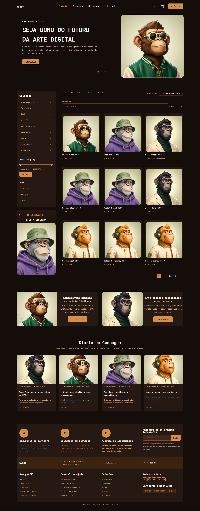

# Kurio · NFT Marketplace

Marketplace de arte digital desenvolvido como desafio frontend. Reúne catálogo, conta, favoritos, carrinho e compra completa, com API simulada e atualizações em tempo real.

**[Ver demonstração](https://frontend-challenge-kurio-thiago-gomes-projects1.vercel.app/)** · [Testes e evidências](reports/README.md) · [Arquitetura](ARCHITECTURE.md)



## Experimente

Use **ana@kurio.test / Kurio123!**, escolha um NFT e conclua a compra. O cupom **KURIO10** aplica desconto. A conta **bruno@kurio.test**, com a mesma senha, permite conferir a separação de dados entre usuários.

Dados, carteiras e pagamentos são fictícios e persistem neste navegador. Não há transação financeira, integração blockchain ou envio real de e-mail.

## Funcionalidades

- Busca, filtros combinados, ordenação e paginação preservados na URL e no histórico.
- Detalhe do NFT, galeria, favoritos e carrinho persistidos por usuário.
- Cadastro, login, expiração de sessão, perfil, avatar, senha e carteiras com validação.
- Checkout com cupom, confirmação pela API simulada, recibo e recuperação do mesmo pedido após timeout.
- Preço e disponibilidade via cliente Socket.IO, com reconexão e tratamento de eventos antigos e duplicados.
- Interface responsiva, navegação por teclado e controle de foco nos diálogos.
- Banners com filtros próprios, quatro artigos e inscrição demonstrativa na newsletter.

## Tecnologias e decisões

React 19, TypeScript e Vite compõem a interface. TanStack Router mantém a navegação e os filtros; TanStack Query gerencia dados remotos e cache. Axios acessa os handlers REST do MSW. Eventos passam pelo cliente Socket.IO. Tailwind CSS cuida dos estilos; Playwright e Lighthouse apoiam a validação.

A compra só é confirmada após resposta da simulação. Os mocks funcionam também na demonstração publicada.

## Executar localmente

Requer **Node.js 22.19+ da linha 22** e npm.

```sh
git clone https://github.com/Thiago-A-Gomes/frontend-challenge-kurio.git
cd frontend-challenge-kurio/Kurio
npm ci
npm run dev
```

Abra a URL informada pelo Vite. Os mocks vêm habilitados; veja [.env.example](.env.example).

## Testes e qualidade

```sh
npm run check
npx playwright install chromium
npm run test:e2e -- --workers=1
npm run test:report
```

**Última suíte completa: 74 testes aprovados**, sem falhas, instáveis ou ignorados, em Chromium desktop (1440×900) e mobile (390×844). Inclui oito comparações visuais de início, detalhe, carrinho e pagamento, com baselines versionadas.

Os testes verificam operações reais da simulação: REST via MSW, eventos via Socket.IO, compra, conta, isolamento entre usuários, erros, recuperação e teclado. Cada teste começa em contexto isolado; cenários sensíveis ao tempo controlam relógio, latência ou eventos conforme necessário.

[Testes](tests/e2e) · [Resumo da execução](reports/tests/ANALISE.md) · [Relatório HTML (ZIP)](reports/tests/html-report.zip) · [Traces investigados](reports/tests/initial-failures)

A evidência entregue é de testes E2E e regressão visual. Não se afirma adoção de TDD ou cobertura unitária inexistente.

## Desempenho

Medianas de três auditorias por página e perfil, em build local otimizado com imagens, fontes e mocks ativos:

| Página / perfil | Desempenho | Acessibilidade | Boas práticas | SEO |
| --- | ---: | ---: | ---: | ---: |
| Início / mobile | 89 | 100 | 100 | 100 |
| Início / desktop | 99 | 100 | 100 | 100 |
| Detalhe / mobile | 90 | 97 | 100 | 100 |
| Detalhe / desktop | 100 | 97 | 100 | 100 |

**Pendência conhecida:** início mobile um ponto abaixo da meta de desempenho 90. Estas medições locais não representam auditoria da Vercel. [Condições, LCP, CLS e TBT](reports/lighthouse/MEDIANAS.md) · [Auditorias HTML/JSON (ZIP)](reports/lighthouse/audit-reports.zip).

## Organização e documentação

O código separa inicialização e rotas (src/app), telas (src/pages), casos de uso (src/features), blocos de interface (src/widgets), contratos e componentes (src/shared) e simulação (src/mocks).

[Arquitetura](ARCHITECTURE.md) · [API e cenários](API.md) · [Execução, auditorias e deploy](docs/EXECUCAO.md) · [Guia do código](docs/CODE_GUIDE.md) · [Segurança](docs/SECURITY.md)

## Limitações

Criadores e Aprenda possuem telas “Em breve”; login social não está integrado. A newsletter registra apenas a inscrição local simulada. Autenticação, persistência e pagamento de produção exigem backend confiável. Resultados, diagnósticos e demais limitações estão na [revisão técnica](reports/REVISAO_GERAL.md).
